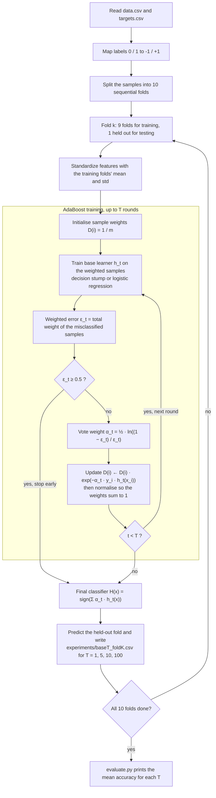

# AdaBoost from Scratch

AdaBoost for binary classification, written from scratch with NumPy and no machine-learning libraries. It supports two base learners, a **decision stump** and a **weighted logistic regression**, and is evaluated with 10-fold cross-validation for ensembles of 1, 5, 10 and 100 base learners.

## 1. Introduction

This is the final project for a Machine Learning course. The assignment asks for AdaBoost with both base learners, implemented without any ready-made model library, and scored by a fixed evaluation script.

The repository holds two independent implementations of the same algorithm. Both read the same data, use the same folds and write the same output format, so the provided `evaluate.py` can score either one.

### Contents

| Path | What it is |
|---|---|
| `Tools/adaboost.py` | A second implementation written as plain NumPy functions, with self-tests on toy data. |
| `Tools/evaluate.py` | Evaluation script supplied with the assignment. Prints the mean 10-fold accuracy for T = 1, 5, 10, 100. |
| `Tools/data.csv`, `Tools/targets.csv` | Dataset: 3,680 samples, 57 numeric features, labels 0 / 1 (1,478 positive, 2,202 negative). No header row. |
| `Tools/experiments/` | Prediction files `base{T}_fold{k}.csv`. Column 1 is the sample number (starting at 1), column 2 the predicted label. |

### Running it

Requires Python 3 with NumPy, plus pandas for `main.py`. Tested with Python 3.14.3, NumPy 2.4.3 and pandas 3.0.2.

```bash
cd Tools

# base learner id: 0 = logistic regression, 1 = decision stump
python adaboost.py data.csv targets.csv 1
python evaluate.py

# toy-data self-tests of adaboost.py
python adaboost.py test
```

Both scripts write into the same `experiments/` folder and overwrite each other's files, so run `evaluate.py` straight after the script you want to score. The folder must already exist; neither script creates it, as the assignment requires.

## 2. Methodology



Each round trains one base learner on the current sample weights, then raises the weight of the samples it got wrong so the next learner concentrates on them. The mean and standard deviation used for standardization come from the training folds only, so nothing about the held-out fold leaks into training.

## 3. Formulas and benchmark results

### 3.1 AdaBoost

AdaBoost builds an additive model of base learners and fits it by minimising the exponential loss, with labels $y_i \in \lbrace -1, +1 \rbrace$:

```math
H_T(x) = \sum_{t=1}^{T} \alpha_t h_t(x), \qquad \ell_{\exp}(H) = \sum_{i=1}^{m} \exp\bigl(-y_i H(x_i)\bigr)
```

The sample weights start uniform:

```math
D_1(i) = \frac{1}{m}
```

In round $t$ the base learner is trained to minimise the weighted error, which is then measured:

```math
h_t = \arg\min_{h} \sum_{i=1}^{m} D_t(i)\, \mathbb{I}\bigl[h(x_i) \ne y_i\bigr], \qquad \varepsilon_t = \sum_{i=1}^{m} D_t(i)\, \mathbb{I}\bigl[h_t(x_i) \ne y_i\bigr]
```

Setting the derivative of the exponential loss with respect to $\alpha_t$ to zero gives the vote weight of the learner:

```math
\alpha_t = \frac{1}{2} \ln \frac{1 - \varepsilon_t}{\varepsilon_t}
```

The weights are then updated and normalised. A correctly classified sample is multiplied by $e^{-\alpha_t}$, a misclassified one by $e^{+\alpha_t}$:

```math
D_{t+1}(i) = \frac{D_t(i)\, \exp\bigl(-\alpha_t\, y_i\, h_t(x_i)\bigr)}{Z_t}, \qquad Z_t = \sum_{j=1}^{m} D_t(j)\, \exp\bigl(-\alpha_t\, y_j\, h_t(x_j)\bigr)
```

The final prediction is the sign of the weighted vote:

```math
\hat{y}(x) = \operatorname{sign}\Bigl(\sum_{t=1}^{T} \alpha_t h_t(x)\Bigr)
```

### 3.2 Decision stump

A stump tests one feature $j$ against one threshold $\theta$, with a direction $s \in \lbrace -1, +1 \rbrace$:

```math
h(x) = \begin{cases} s, & x_j \le \theta \\ -s, & x_j > \theta \end{cases}
```

Training picks the combination with the smallest weighted error. The candidate thresholds are the midpoints between consecutive distinct values of the feature, plus one value below the minimum:

```math
(j^{*}, \theta^{*}, s^{*}) = \arg\min_{j,\, \theta,\, s} \sum_{i=1}^{m} D(i)\, \mathbb{I}\bigl[h(x_i) \ne y_i\bigr]
```

Flipping the direction turns an error of $\varepsilon$ into $1 - \varepsilon$, so both directions come from one pass over the thresholds.

### 3.3 Weighted logistic regression

With $\tilde{y}_i = (y_i + 1)/2 \in \lbrace 0, 1 \rbrace$, the model and its sample-weighted cross-entropy cost are:

```math
p_i = \sigma(w^{\top} x_i + b), \qquad \sigma(z) = \frac{1}{1 + e^{-z}}
```

```math
J(w, b) = -\sum_{i=1}^{m} D(i) \Bigl[ \tilde{y}_i \ln p_i + (1 - \tilde{y}_i) \ln (1 - p_i) \Bigr]
```

It is minimised by gradient descent with learning rate $\eta$:

```math
\nabla_w J = X^{\top} \bigl( D \odot (p - \tilde{y}) \bigr), \qquad \frac{\partial J}{\partial b} = \sum_{i=1}^{m} D(i)\,(p_i - \tilde{y}_i)
```

```math
w \leftarrow w - \eta\, \nabla_w J, \qquad b \leftarrow b - \eta\, \frac{\partial J}{\partial b}
```

The prediction is $+1$ when $p \ge 0.5$ and $-1$ otherwise. `main.py` uses the equivalent margin form $\sum_i D(i) \ln\bigl(1 + e^{-y_i w^{\top} x_i}\bigr)$ and adds an L2 penalty $\tfrac{\lambda}{2} \lVert w \rVert^2$ with $\lambda = 10^{-4}$.

Features are standardized before training, using statistics from the training folds:

```math
z = \frac{x - \mu_{\text{train}}}{\sigma_{\text{train}}}
```

### 3.4 Evaluation

`evaluate.py` reports, for each $T$, the accuracy averaged over the ten test folds $F_1, \dots, F_{10}$:

```math
\text{acc}(T) = \frac{1}{10} \sum_{k=1}^{10} \frac{1}{|F_k|} \sum_{i \in F_k} \mathbb{I}\bigl[\hat{y}^{(T)}_i = y_i\bigr]
```

### 3.5 Benchmark results

Mean 10-fold accuracy printed by `evaluate.py`, on the 3,680-sample dataset:

| Base learner | Implementation | T = 1 | T = 5 | T = 10 | T = 100 | Run time |
|---|---|---|---|---|---|---|
| Decision stump | `main.py` | 70.63% | 88.37% | 87.09% | 92.09% | 101 s |
| Decision stump | `adaboost.py` | 70.63% | 88.37% | 87.09% | 92.15% | 357 s |
| Logistic regression | `main.py` | 87.96% | 87.80% | 87.61% | 87.47% | 17 s |
| Logistic regression | `adaboost.py` | 89.73% | 89.73% | 89.73% | 89.73% | 13 s |

Run time is the wall-clock time each script reports for all 40 prediction files, from a single run on a Ryzen 9 8945HX laptop with the four jobs running at the same time. Treat it as approximate.

What the numbers show:

- **The two stump implementations agree.** They search for the best stump in different ways, yet their predictions are identical for T = 1, 5 and 10, and differ on only 4 of the 3,680 samples at T = 100 (3,389 against 3,391 correct). The exhaustive search in `adaboost.py` costs about 3.5 times the run time.
- **Boosting helps the stump a great deal.** A single stump scores 70.63% and recognises only 56.5% of the positive class. One hundred stumps reach 92%. The gain is not monotonic: T = 10 is lower than T = 5.
- **Boosting does almost nothing for logistic regression.** In `adaboost.py` the predictions are identical for every T. In the folds inspected, the first model has ε ≈ 0.07 and α ≈ 1.3, while the later models have ε between 0.28 and 0.46 and a combined α of about 0.7, too little to overturn the first vote. Training then stops after 4 to 7 rounds, when ε reaches 0.5. In `main.py` the accuracy drifts down slightly as T grows.
- **The gap between the two logistic regressions comes from the optimiser settings.** Training `main.py`'s logistic regression with a learning rate of 1.0 for 2,000 iterations and no penalty also gives 89.73% at T = 1.

One caveat about the split: the data file is sorted by class (samples 1 to 1,478 are positive, the rest negative) and the folds are contiguous blocks, so each test fold holds almost only one class. Both scripts use the same folds, which keeps the comparison between them fair, but the absolute accuracies are specific to this split.

`adaboost.py` was also checked against the worked example in the lecture notes: on the four-point XOR data it gives ε = 1/4, 1/6, 1/10 and α = 0.549, 0.805, 1.099, and classifies all four points correctly after three rounds.
